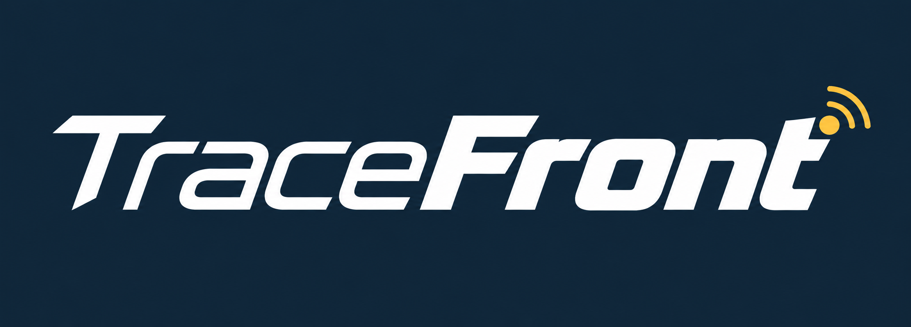

# TraceFront

<p align="center">
  
</p>

<p align="center"><strong>Real-time AI-assisted decision support for food safety incidents.</strong></p>

<p align="center">
  <a href="SETUP.md">Quick Setup</a> •
  <a href="docs/demo-runbook.md">Demo Runbook</a> •
  <a href="docs/schema-and-api.md">Schema & API</a>
</p>

---

## Project at a glance

| Item | Details |
| --- | --- |
| Status | Demo-ready MVP with durable backend analysis storage and trace workflow |
| Frontend | Next.js 14 + React + Tailwind (`frontend/`) |
| Backend | FastAPI + SQLAlchemy (`backend/`) |
| Data store | PostgreSQL on LinuxONE (local SQLite/Postgres also supported for dev) |
| ML services | LinuxONE-hosted pathogen models (`food-risk-ml/`) + backend cold-chain rule engine |
| Default local ports | Frontend `3000`, Backend `8000`, ML service `8100` |

---

## 5W1H: what this project is and how it works

### What
TraceFront helps a food-safety operator go from a shipment file to an explainable containment decision:
1. Detect anomalies in uploaded logistics/sensor data.
2. Visualize distribution paths.
3. Trace related lots across upstream/downstream links.
4. Record a human decision with evidence and audit history.

### Why
Food incidents require fast but defensible action. TraceFront is designed to reduce time-to-decision while keeping uncertainty explicit:
- findings include rule/evidence context,
- trace results show leads (not proof),
- final containment action is recommended by the system but approved by a person.

### Who
Primary users and stakeholders:
- food safety officers / incident responders,
- operations teams (warehouse/store/factory coordination),
- demo evaluators and presenters,
- contributors extending frontend, backend, data, and ML components.

### When
Use TraceFront during incident triage, investigation, and response review:
- right after an upload-based anomaly investigation,
- during cross-lot contamination tracing,
- when documenting who approved what and why.

### Where
- **Presentation/ops environment:** shared LinuxONE services (backend, database, ML) reached through local SSH tunnel.
- **Contributor environment:** local frontend + optional local backend for development.

### How
High-level flow:

```text
Upload file -> Backend analysis -> Findings + Distribution graph
            -> Lot trace query -> Containment recommendation
            -> Officer approval/rejection -> Durable decision history
```

---

## Current scope and status

### Implemented now
- Upload analysis (`.csv`, `.xlsx`, `.json`) with durable findings/distribution records.
- Lot trace investigation with upstream/downstream/related lot ranking.
- Containment decision recording (approve/reject) with officer, reason, and timestamp.
- Demo synthetic scenario seeding (`POST /api/demo/seed`, idempotent).
- Frontend workflow pages (`/`, `/distribution`, `/trace`, `/analysis-results`).

### Not fully built yet
- Live event replay remains pending.
- Hold execution is **simulated** (recorded decision, no outbound execution).
- Uploaded cold-chain findings are rule-based, not a trained contamination detector.

---

## Architecture and components

| Component | Path | Role |
| --- | --- | --- |
| Frontend app | `frontend/` | UI for upload, findings, distribution, trace, and decision workflow |
| Backend API | `backend/` | Persistence, trace logic, upload analysis endpoints, decision storage |
| ML service + model assets | `food-risk-ml/` | Pathogen model serving and model documentation/evidence |
| Data pipeline package | `src/tracefront_data/` | Offline ingestion/cleaning/feature/handoff workflows |
| Documentation | `docs/`, `reports/` | API details, runbooks, demo script, data/model audit artifacts |

---

## Key user flows

1. **Detect**: upload shipment/sensor file and review findings.
2. **Spread**: inspect distribution tree to see where affected batches moved.
3. **Trace**: open lot investigation and inspect connected upstream/downstream lots.
4. **Decide**: compare targeted vs extended hold options and record officer decision.

Detailed presenter script: [docs/demo-script.md](docs/demo-script.md)

---

## Setup and run

> **Recommended first read:** [SETUP.md](SETUP.md)

### A) Use the shared LinuxONE backend + ML services (demo/presentation path)

From repository root in PowerShell:

```powershell
.\backend\demo-tunnel.ps1
```

Then verify service readiness:

```powershell
python -B backend\preflight.py
```

Run frontend:

```powershell
cd frontend
npm install
npm run dev
```

Open: http://localhost:3000

### B) Run backend locally (for backend development)

From repository root:

```bash
cd backend
python -m venv .venv
python -m pip install -r requirements.txt
cp .env.example .env
uvicorn app.main:app --reload
```

API docs: http://localhost:8000/docs

Windows (PowerShell) variant used in project docs:

```powershell
cd backend
python -m venv .venv
.\.venv\Scripts\python -m pip install -r requirements.txt
Set-Content .env "DATABASE_URL=sqlite:///./tracefront.db"
.\.venv\Scripts\python -m uvicorn app.main:app --reload --port 8000
```

### C) Optional direct SSH tunnel (backend + database)

```bash
ssh -L 8000:127.0.0.1:8000 -L 5432:127.0.0.1:5432 linux1@148.100.77.171
```

While open:
- API: http://localhost:8000
- DB: `localhost:5432`

---

## Important endpoints

### Backend API (selected)

| Method | Path | Purpose |
| --- | --- | --- |
| GET | `/api/health` | Backend/database health |
| GET/POST | `/api/batches` | List/create batches |
| GET/POST | `/api/organizations` | List/create organizations |
| GET/POST | `/api/shipments` | List/create shipments |
| GET/POST | `/api/batch-relationships` | List/create ingredient-product links |
| GET | `/api/trace?batch_ids=<id>&batch_ids=<id>` | Multi-batch lot investigation |
| GET | `/api/batches/{id}/trace` | Single-batch trace document |
| POST | `/api/demo/seed` | Load synthetic demo scenario (idempotent) |
| POST | `/api/decisions` | Record containment decision |
| POST | `/api/analyses` | Upload and analyze shipment file |
| GET | `/api/analyses/{id}/findings` | Retrieve stored findings |
| GET | `/api/analyses/{id}/distribution` | Retrieve stored distribution graph |
| GET | `/api/shipments/{id}/risk` | Rule-based shipment risk |
| POST | `/api/sensor-readings` | Store shipment sensor reading |
| POST | `/api/lab-results` | Store lab result |

### Frontend routes (selected)

- `/` upload and incident entry flow
- `/distribution` distribution graph and trace handoff
- `/trace` lot investigation and containment decision
- `/analysis-results` findings view
- `/reports` legacy sample UI data page
- `/design` mockup-to-screen design workspace
- `/ml-process` analysis animation preview

---

## Demo and presentation workflow

1. Tunnel to LinuxONE (`.\backend\demo-tunnel.ps1`).
2. Run backend/ML readiness check (`python -B backend\preflight.py`).
3. Start frontend (`npm run dev`, or `npm run build` then `npm start` for final frozen presentation build).
4. Run through Detect → Spread → Trace → Decide flow.

Canonical references:
- [docs/demo-runbook.md](docs/demo-runbook.md)
- [docs/demo-script.md](docs/demo-script.md)
- [docs/demo-validation.md](docs/demo-validation.md)

---

## Data and model caveats (read before presenting)

- Trace connections are **investigation leads**, not proof of causation.
- Approved hold actions are **simulated records**; they are not dispatched to real sites.
- Uploaded shipment analysis is rule-based and transparent; it is not a trained contamination classifier.
- Pathogen model outputs concern FSIS laboratory sample prioritization, not direct shipment-file contamination verdicts.
- Demo synthetic scenario rows are intentionally additive/idempotent for repeat demos.

---

## Repository structure

```text
backend/            FastAPI backend, API logic, tests, deploy/tunnel scripts
frontend/           Next.js frontend pages and UI components
food-risk-ml/       Model serving stack, model cards, LinuxONE evidence
src/tracefront_data Offline data pipeline package
docs/               Runbooks, schema/API documentation, demo guides
reports/            Audits, data-quality/leakage findings, modeling handoff artifacts
data/               Raw/interim/processed data and manifests
configs/            Pipeline/data contract configuration
tests/              Offline data pipeline-focused tests
```

---

## Deeper technical documentation

### Product + API
- [SETUP.md](SETUP.md)
- [docs/schema-and-api.md](docs/schema-and-api.md)
- [docs/codex-handoff.md](docs/codex-handoff.md)

### Demo operations
- [docs/demo-runbook.md](docs/demo-runbook.md)
- [docs/demo-script.md](docs/demo-script.md)
- [docs/demo-readiness-review.md](docs/demo-readiness-review.md)

### Data pipeline and modeling artifacts
- [reports/repository_audit.md](reports/repository_audit.md)
- [reports/modeling_handoff.md](reports/modeling_handoff.md)
- [reports/modeling_handoff.json](reports/modeling_handoff.json)
- [reports/data_leakage_audit.md](reports/data_leakage_audit.md)
- [reports/m8_validation.json](reports/m8_validation.json)

For the full concept narrative/specification, see [tracefront_project_summary.md](tracefront_project_summary.md).
